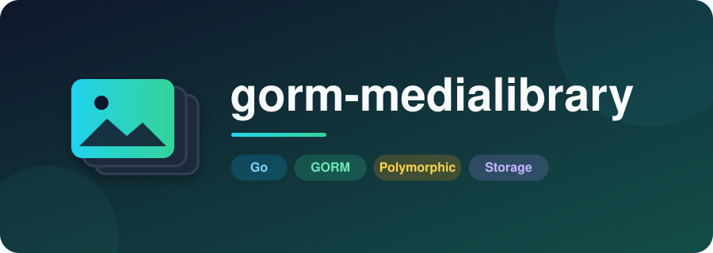

<p align="center">
  
</p>

<p align="center">
  
</p>

<p align="center">
  Spatie Laravel Media Library–compatible media attachments for GORM.
</p>

<p align="center">
  <a href="https://github.com/noormaulida/gorm-medialibrary/actions/workflows/go.yml">
    
  </a>
  <a href="https://codecov.io/gh/noormaulida/gorm-medialibrary">
    
  </a>
  <a href="https://pkg.go.dev/github.com/noormaulida/gorm-medialibrary">
    
  </a>
  <a href="https://github.com/noormaulida/gorm-medialibrary/blob/master/LICENSE">
    
  </a>
</p>

## Features

- Spatie-compatible `media` table (morph model, collections, conversions JSON, UUID, order)
- Attach files from path or `io.Reader`
- Named collections (`singleFile`, MIME allow-list)
- Image conversions (fit / crop) via `disintegration/imaging`
- Responsive images generation (width variants + tiny SVG placeholder, Spatie JSON shape)
- Pluggable `Disk` interface — `LocalDisk` and built-in `S3Disk` (AWS SDK v2 / S3-compatible)
- Per-collection / per-upload disk selection (`Disk`, `OnDisk`)
- Compensating cleanup on failed uploads; `singleFile` replaces only after success
- Path layout mirrors Spatie: `{id}/{file}`, `{id}/conversions/`, `{id}/responsive-images/`
- Go **1.24** or higher

## Installation

```bash
go get github.com/noormaulida/gorm-medialibrary@latest
```

## Setup

```go
disk := medialibrary.NewLocalDisk("public", "./storage/app/public", "/storage")

lib := medialibrary.New(db,
    medialibrary.WithDisk(disk),
    medialibrary.WithDefaultDisk("public"),
)

if err := medialibrary.Migrate(db); err != nil {
    return err
}
```

`Migrate` is optional when the database already uses Spatie Media Library migrations.

## HasMedia model

```go
type SeoMeta struct {
    ID    uint64
    Title string
}

func (s SeoMeta) MediaModelID() uint64   { return s.ID }
func (s SeoMeta) MediaModelType() string { return "seo_metas" }
```

Use a stable morph alias when sharing rows with Laravel.

## Register collections and conversions

```go
lib.Register("seo_metas", func(r *medialibrary.Registrar) {
    r.Collection("seo_image").
        SingleFile().
        AcceptsMimeTypes("image/jpeg", "image/png").
        Disk("public").                 // optional; default library disk
        // ConversionsDisk("s3").       // optional separate disk
        WithResponsiveImages()

    r.Conversion("seo_image_large").
        ForCollection("seo_image").
        Crop(1200, 630).
        Quality(85).
        WithResponsiveImages()

    r.Conversion("seo_image_small").
        ForCollection("seo_image").
        Crop(240, 126)
})
```

## Add and read media

```go
src, err := medialibrary.FromPath("./uploads/hero.jpg")
if err != nil {
    return err
}

media, err := lib.AddMedia(ctx, seoMeta, "seo_image", src)
// Or override disk for this upload:
// media, err := lib.AddMedia(ctx, seoMeta, "seo_image", src, medialibrary.OnDisk("s3"))
if err != nil {
    return err
}

url, _ := lib.GetURL(*media)                       // original
large, _ := lib.GetURL(*media, "seo_image_large")   // conversion
first, _ := lib.GetFirstMediaURL(seoMeta, "seo_image", "seo_image_small")
srcset, _ := lib.GetSrcset(*media)                 // responsive srcset
```

Also available: `GetMedia`, `GetFirstMedia`, `GetResponsiveImageURLs`, `ClearMediaCollection`, `Delete`.

### From an HTTP upload

```go
file, header, _ := c.Request.FormFile("image")
defer file.Close()
src, err := medialibrary.FromReader(file, header.Filename, header.Header.Get("Content-Type"))
```

## S3 disk (built-in)

```go
import (
    "github.com/aws/aws-sdk-go-v2/config"
    "github.com/aws/aws-sdk-go-v2/service/s3"
)

cfg, err := config.LoadDefaultConfig(ctx)
if err != nil {
    return err
}
client := s3.NewFromConfig(cfg)

disk, err := medialibrary.NewS3Disk(medialibrary.S3DiskConfig{
    Name:    "s3",
    Bucket:  "my-bucket",
    Prefix:  "media", // optional
    BaseURL: "https://cdn.example.com",
    Client:  client,
})
if err != nil {
    return err
}
lib := medialibrary.New(db, medialibrary.WithDisk(disk), medialibrary.WithDefaultDisk("s3"))
```

Works with any S3-compatible API (MinIO, R2, etc.) by configuring the AWS SDK endpoint.
For GCS or other backends, implement `medialibrary.Disk` yourself.

## Spatie compatibility notes

| Concern | Guidance |
|---------|----------|
| Table / columns | Same defaults as Spatie v9+ style used by SuitCMS |
| `model_type` | Prefer morph alias (`seo_metas`) shared with Laravel |
| File paths | `{id}/{file_name}`, conversions under `{id}/conversions/`, responsive under `{id}/responsive-images/` |
| Responsive images | `WithResponsiveImages()` on collection/conversion; JSON keyed by `media_library_original` / conversion name |

## Minimum Go version

Go **1.24** or higher (required by the AWS SDK v2 S3 client).

## License

MIT License
